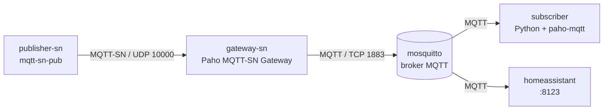

# Home Assistant + MQTT + MQTT-SN em contêineres

Ambiente experimental com Docker Compose para integrar dispositivos IoT ao Home Assistant usando MQTT, MQTT-SN e um gateway de conversão entre os protocolos.

- **Autor:** Wellington Antonio da Silva
- **Curso:** Redes de Computadores – IFPB
- **Disciplina:** Redes Convergentes

## Sumário

1. [Arquitetura](#1-arquitetura)
2. [Estrutura do repositório](#2-estrutura-do-repositório)
3. [Pré-requisitos](#3-pré-requisitos)
4. [Arquivos de configuração](#4-arquivos-de-configuração)
5. [Dockerfiles e código](#5-dockerfiles-e-código)
6. [Orquestração (compose.yaml)](#6-orquestração-composeyaml)
7. [Como iniciar, parar e verificar](#7-como-iniciar-parar-e-verificar)
8. [Configuração do Home Assistant](#8-configuração-do-home-assistant)
9. [Testes realizados](#9-testes-realizados)
10. [Problemas encontrados e soluções](#10-problemas-encontrados-e-soluções)
11. [Como reproduzir o ambiente](#11-como-reproduzir-o-ambiente)
12. [Limitações e observações](#12-limitações-e-observações)

## 1. Arquitetura

Todos os serviços rodam em contêineres ligados a uma rede bridge Docker chamada `iot`. Dentro dela, cada serviço é encontrado pelo nome. A interface da bridge tem o nome fixo `br-iot`, o que facilita a captura de pacotes.



Fluxo: o publisher envia a temperatura por MQTT-SN (UDP) ao gateway. O gateway converte a mensagem em MQTT (TCP) e a publica no broker. O broker a entrega ao subscriber, que imprime o valor, e ao Home Assistant, que mostra o valor em um sensor.

### Componentes

| Serviço | Imagem | Função |
|---|---|---|
| `mosquitto` | `eclipse-mosquitto:2` (pronta) | Broker MQTT. Recebe e distribui as mensagens. Porta TCP 1883. |
| `gateway-sn` | construída a partir do [Eclipse Paho MQTT-SN Gateway](https://github.com/eclipse/paho.mqtt-sn.embedded-c) | Recebe MQTT-SN por UDP (porta 10000) e publica no broker como MQTT. |
| `publisher-sn` | construída a partir do [mqtt-sn-tools](https://github.com/njh/mqtt-sn-tools) | Simula um dispositivo IoT. Publica uma temperatura aleatória (20 a 29) em `casa/sala/temperatura` a cada 5 segundos, via MQTT-SN. |
| `subscriber` | construída com Python 3.12 e `paho-mqtt` | Assina `casa/#` no broker e imprime as mensagens recebidas. |
| `homeassistant` | `ghcr.io/home-assistant/home-assistant:stable` (pronta) | Plataforma de automação e visualização. Lê o tópico pelo broker e exibe o sensor "Temperatura da Sala". Porta 8123. |

## 2. Estrutura do repositório

```
.
├── compose.yaml
├── mosquitto/config/mosquitto.conf
├── homeassistant/config/configuration.yaml
├── gateway/
│   ├── Dockerfile
│   └── gateway.conf
├── publisher/
│   ├── Dockerfile
│   └── publish.sh
├── subscriber/
│   ├── Dockerfile
│   └── subscriber.py
└── evidencias/          # logs, capturas de tela e captura de pacotes
```

## 3. Pré-requisitos

- Linux com Docker Engine e plugin Docker Compose. O ambiente foi testado em Ubuntu e em Linux Mint, com Docker Compose v5.6.1.
- Portas livres no host: **1883** (TCP), **8123** (TCP) e **10000** (UDP).
- Acesso à internet, para baixar as imagens e compilar o gateway e o publisher.

### Instalar o Docker (Ubuntu / Linux Mint)

No Linux Mint, o repositório do Docker usa o nome do Ubuntu em que o Mint se baseia, por isso o comando usa `UBUNTU_CODENAME`. No Ubuntu, esse campo também existe, então o mesmo comando serve para os dois.

```bash
sudo apt update
sudo apt install -y ca-certificates curl
sudo install -m 0755 -d /etc/apt/keyrings
sudo curl -fsSL https://download.docker.com/linux/ubuntu/gpg -o /etc/apt/keyrings/docker.asc
sudo chmod a+r /etc/apt/keyrings/docker.asc
echo "deb [arch=$(dpkg --print-architecture) signed-by=/etc/apt/keyrings/docker.asc] https://download.docker.com/linux/ubuntu $(. /etc/os-release && echo $UBUNTU_CODENAME) stable" | sudo tee /etc/apt/sources.list.d/docker.list
sudo apt update
sudo apt install -y docker-ce docker-ce-cli containerd.io docker-buildx-plugin docker-compose-plugin
sudo usermod -aG docker $USER
newgrp docker
docker compose version
```

### Liberar as portas

Se houver um Mosquitto instalado no sistema, ele ocupa a porta 1883 e impede o contêiner de subir:

```bash
sudo ss -lntup | grep -E ':1883|:8123|:10000'
sudo systemctl stop mosquitto
sudo systemctl disable mosquitto
```

## 4. Arquivos de configuração

### Broker (`mosquitto/config/mosquitto.conf`)

O Mosquitto 2 exige a diretiva `listener` explícita para aceitar conexões de outros contêineres. A autenticação anônima é aceitável apenas por se tratar de um ambiente de laboratório.

```
listener 1883
allow_anonymous true
persistence false
log_dest stdout
```

### Gateway MQTT-SN (`gateway/gateway.conf`)

`BrokerName` aponta para o nome do serviço do broker na rede Docker (`mosquitto`), e não para `127.0.0.1`. As chaves `MulticastIP` e `MulticastPortNo` são necessárias para o gateway abrir o socket UDP (ver [seção 10](#10-problemas-encontrados-e-soluções)).

```
BrokerName=mosquitto
BrokerPortNo=1883
BrokerSecurePortNo=8883
GatewayID=1
GatewayName=PahoGateway-01
GatewayPortNo=10000
MulticastIP=225.1.1.1
MulticastPortNo=1235
ClientAuthentication=NO
```

### Home Assistant (`homeassistant/config/configuration.yaml`)

Define o sensor que lê o tópico publicado pelo gateway. O `unique_id` faz a entidade aparecer na lista de Entidades da interface.

```yaml
default_config:

mqtt:
  - sensor:
      - name: "Temperatura da Sala"
        unique_id: temperatura_sala
        state_topic: "casa/sala/temperatura"
        unit_of_measurement: "°C"
```

## 5. Dockerfiles e código

### Gateway (`gateway/Dockerfile`)

O gateway não tem imagem pronta. Ele é compilado a partir do repositório oficial do Eclipse Paho em um estágio de build. Na imagem final ficam o binário, a biblioteca compartilhada `libMQTTSNPacket.so` e os arquivos `.conf`. O `RUN ldd` lista as bibliotecas usadas pelo binário e faz o build falhar se alguma estiver faltando.

```dockerfile
FROM ubuntu:24.04 AS build
RUN apt-get update && apt-get install -y git build-essential cmake libssl-dev
ENV CMAKE_POLICY_VERSION_MINIMUM=3.5
RUN git clone https://github.com/eclipse/paho.mqtt-sn.embedded-c.git /src
WORKDIR /src/MQTTSNGateway
RUN ./build.sh udp
RUN mkdir -p /opt/gw && \
    cp "$(find /src -name MQTT-SNGateway -type f | head -1)" /opt/gw/ && \
    cp clients.conf predefinedTopic.conf /opt/gw/ && \
    find /src -name 'libMQTTSNPacket.so*' -exec cp -a {} /opt/gw/ \;

FROM ubuntu:24.04
RUN apt-get update && apt-get install -y libssl3 && rm -rf /var/lib/apt/lists/*
COPY --from=build /opt/gw /opt/gw
ENV LD_LIBRARY_PATH=/opt/gw
WORKDIR /opt/gw
RUN ldd ./MQTT-SNGateway
CMD ["./MQTT-SNGateway", "-f", "gateway.conf"]
```

### Publisher MQTT-SN (`publisher/Dockerfile` e `publisher/publish.sh`)

O `mqtt-sn-tools` também é compilado na imagem. O commit está fixado (`a1dd870`) e uma linha de `mqtt-sn.c` é corrigida antes da compilação, por causa de um bug que derrubava o programa (ver [seção 10](#10-problemas-encontrados-e-soluções)). O `grep` faz o build falhar se a correção não for aplicada.

```dockerfile
FROM ubuntu:24.04
RUN apt-get update && apt-get install -y git build-essential
RUN git clone https://github.com/njh/mqtt-sn-tools.git /src && cd /src && \
    git checkout a1dd870 && \
    sed -i 's/memcpy(packet.data, data, sizeof(packet.data));/memcpy(packet.data, data, data_len);/' mqtt-sn.c && \
    grep -n 'memcpy(packet.data, data, data_len)' mqtt-sn.c && \
    make && make install
COPY publish.sh /publish.sh
RUN chmod +x /publish.sh
CMD ["/publish.sh"]
```

```bash
#!/bin/bash
sleep 5
while true; do
  T=$((20 + RANDOM % 10))
  if mqtt-sn-pub -h gateway-sn -p 10000 -t casa/sala/temperatura -m "$T"; then
    echo "publicado: $T"
  else
    echo "falha ao publicar: $T"
  fi
  sleep 5
done
```

### Subscriber MQTT (`subscriber/Dockerfile` e `subscriber/subscriber.py`)

```dockerfile
FROM python:3.12-slim
RUN pip install paho-mqtt
COPY subscriber.py /subscriber.py
CMD ["python", "-u", "/subscriber.py"]
```

```python
import paho.mqtt.client as mqtt

def on_connect(c, u, f, rc, p=None):
    c.subscribe("casa/#")

def on_message(c, u, m):
    print(f"{m.topic}: {m.payload.decode()}", flush=True)

c = mqtt.Client(mqtt.CallbackAPIVersion.VERSION2)
c.on_connect = on_connect
c.on_message = on_message
c.connect("mosquitto", 1883)
c.loop_forever()
```

## 6. Orquestração (compose.yaml)

```yaml
services:
  mosquitto:
    image: eclipse-mosquitto:2
    volumes:
      - ./mosquitto/config/mosquitto.conf:/mosquitto/config/mosquitto.conf:ro
    ports: ["1883:1883"]
    networks: [iot]

  homeassistant:
    image: ghcr.io/home-assistant/home-assistant:stable
    volumes:
      - ./homeassistant/config:/config
    ports: ["8123:8123"]
    depends_on: [mosquitto]
    networks: [iot]

  gateway-sn:
    build: ./gateway
    volumes:
      - ./gateway/gateway.conf:/opt/gw/gateway.conf:ro
    ports: ["10000:10000/udp"]
    depends_on: [mosquitto]
    networks: [iot]

  subscriber:
    build: ./subscriber
    depends_on: [mosquitto]
    networks: [iot]

  publisher-sn:
    build: ./publisher
    depends_on: [gateway-sn]
    networks: [iot]

networks:
  iot:
    driver: bridge
    driver_opts:
      com.docker.network.bridge.name: br-iot
```

## 7. Como iniciar, parar e verificar

```bash
# construir as imagens e iniciar todos os serviços
docker compose up -d --build

# verificar o estado dos serviços
docker compose ps

# acompanhar os logs
docker compose logs -f gateway-sn subscriber publisher-sn

# reiniciar um serviço (por exemplo, depois de editar o configuration.yaml)
docker compose restart homeassistant

# parar e remover os contêineres
docker compose down
```

O primeiro build demora alguns minutos, porque o gateway e o publisher são compilados dentro das imagens.

## 8. Configuração do Home Assistant

1. Abra `http://localhost:8123` e crie o usuário inicial. A primeira inicialização pode demorar.
2. Vá em **Configurações → Dispositivos e serviços → Adicionar integração** e escolha **MQTT**.
3. Informe o broker `mosquitto` e a porta `1883`. Deixe usuário e senha em branco. Use `mosquitto` e não `localhost`, porque o Home Assistant roda em outro contêiner.
4. Reinicie o Home Assistant para ele carregar o sensor do `configuration.yaml`:
   ```bash
   docker compose restart homeassistant
   ```
5. Abra **Configurações → Dispositivos e serviços → Entidades** e procure **Temperatura da Sala**. O valor muda a cada cerca de 5 segundos.

## 9. Testes realizados

### 9.1 Serviços em execução

Comando: `docker compose ps`. Os cinco serviços aparecem como `Up` e as portas 1883, 8123 e 10000/udp estão publicadas.

```text
NAME                             IMAGE                                          COMMAND                  SERVICE         CREATED          STATUS          PORTS
home-assistant-gateway-sn-1      home-assistant-gateway-sn                      "./MQTT-SNGateway -f…"   gateway-sn      40 minutes ago   Up 25 minutes   0.0.0.0:10000->10000/udp, [::]:10000->10000/udp
home-assistant-homeassistant-1   ghcr.io/home-assistant/home-assistant:stable   "/init"                  homeassistant   47 minutes ago   Up 9 minutes    0.0.0.0:8123->8123/tcp, [::]:8123->8123/tcp
home-assistant-mosquitto-1       eclipse-mosquitto:2                            "/docker-entrypoint.…"   mosquitto       47 minutes ago   Up 47 minutes   0.0.0.0:1883->1883/tcp, [::]:1883->1883/tcp
home-assistant-publisher-sn-1    home-assistant-publisher-sn                    "/publish.sh"            publisher-sn    18 minutes ago   Up 18 minutes
home-assistant-subscriber-1      home-assistant-subscriber                      "python -u /subscrib…"   subscriber      47 minutes ago   Up 47 minutes
```

### 9.2 Fluxo MQTT-SN → gateway → broker → subscriber

O publisher publica a temperatura e o subscriber recebe os mesmos valores, na mesma ordem.

Publisher (`docker compose logs publisher-sn`):

```text
publisher-sn-1  | publicado: 29
publisher-sn-1  | publicado: 20
publisher-sn-1  | publicado: 22
publisher-sn-1  | publicado: 24
publisher-sn-1  | publicado: 29
publisher-sn-1  | publicado: 22
```

Subscriber (`docker compose logs subscriber`):

```text
subscriber-1  | casa/sala/temperatura: 29
subscriber-1  | casa/sala/temperatura: 20
subscriber-1  | casa/sala/temperatura: 22
subscriber-1  | casa/sala/temperatura: 24
subscriber-1  | casa/sala/temperatura: 29
subscriber-1  | casa/sala/temperatura: 22
subscriber-1  | casa/sala/temperatura: 28
subscriber-1  | casa/sala/temperatura: 28
```

### 9.3 Conversão MQTT-SN para MQTT no gateway

Trecho do log do gateway (`docker compose logs gateway-sn`). As setas `<---` e `--->` indicam o lado MQTT-SN (cliente), e `===>` e `<===` indicam o lado MQTT (broker). O `CONNECT` recebido por MQTT-SN vira um `CONNECT` MQTT para o broker, e o `CONNACK` do broker volta ao cliente. Em seguida o cliente registra o tópico `casa/sala/temperatura` (`REGISTER`).

```text
20261027 224727.695   CONNECT           <---  mqtt-sn-tools-28                    16 04 04 01 00 0A 6D 71 74 74 2D 73 6E 2D 74 6F 6F 6C 73 2D 32 38
20261027 224727.696   CONNECT           ===>  mqtt-sn-tools-280                   10 1D 00 04 4D 51 54 54 04 02 00 0A 00 11 6D 71 74 74 2D 73 6E 2D 74 6F 6F 6C 73 2D 32 38 30
20261027 224728.102   CONNACK           <===  mqtt-sn-tools-280                   20 02 00 00
20261027 224728.103   CONNACK           --->  mqtt-sn-tools-280                   03 05 00
20261027 224728.103   REGISTER    0001  <---  mqtt-sn-tools-280                   1B 0A 00 00 00 01 63 61 73 61 2F 73 61 6C 61 2F 74 65 6D 70 65 72 61 74 75 72 61
```

### 9.4 Home Assistant

Integração MQTT adicionada, com uma entidade:


Sensor "Temperatura da Sala" com o valor atual e o histórico. O degrau em 30 °C é o teste manual da seção 9.5. Os demais valores (22 a 29) vieram do publisher MQTT-SN, passando pelo gateway e pelo broker:


### 9.5 Teste manual de publicação MQTT

Publicando direto no broker, sem passar pelo gateway:

```bash
docker compose exec mosquitto mosquitto_pub -t casa/sala/temperatura -m 30
```

O estado do sensor passou a `30`, valor que o publisher MQTT-SN nunca gera (ele gera de 20 a 29):


### 9.6 Captura de pacotes

Com o ambiente rodando e o publisher publicando, a captura é feita na bridge `br-iot`:

```bash
sudo timeout 20 tcpdump -i br-iot -w evidencias/lab.pcap 'udp port 10000 or tcp port 1883'
```

No Wireshark, abra `evidencias/lab.pcap`, selecione um pacote UDP da porta 10000 e use **Analyze → Decode As…** com **UDP port 10000 → MQTT-SN**. O filtro `mqttsn || mqtt` mostra os pacotes MQTT-SN (UDP, entre publisher e gateway) e MQTT (TCP 1883, entre gateway e broker).

## 10. Problemas encontrados e soluções

| Problema | Causa | Solução |
|---|---|---|
| Porta 1883 já em uso | Um Mosquitto instalado no sistema escutava em `127.0.0.1:1883`. | `sudo systemctl stop mosquitto` e `sudo systemctl disable mosquitto`. |
| Erro 401 `personal access token is expired` no build | Credenciais antigas do Docker Hub em `~/.docker/config.json`. As imagens usadas são públicas. | `docker logout`. |
| `./build.sh: not found` no build do gateway | O script fica em `MQTTSNGateway/`, e não na raiz do repositório. | `WORKDIR /src/MQTTSNGateway` na Dockerfile do gateway. |
| Gateway saía com código 127: `libMQTTSNPacket.so: cannot open shared object file` | A biblioteca compartilhada gerada no build não foi copiada para a imagem final. | Copiar `libMQTTSNPacket.so*` no estágio de build, definir `LD_LIBRARY_PATH=/opt/gw` e conferir com `ldd`. |
| Gateway abortava com `Can't open a UDP` | O `gateway.conf` mínimo não tinha as chaves de multicast usadas na abertura do socket. | Adicionar `MulticastIP`, `MulticastPortNo` e demais chaves. Depois disso o gateway passou a subir. |
| `mqtt-sn-pub` com *segmentation fault* | Bug no `mqtt-sn-tools` (commit `a1dd870`). Em `mqtt_sn_send_publish`, a linha `memcpy(packet.data, data, sizeof(packet.data))` copia o tamanho máximo do campo de dados, em vez de `data_len`, e lê além do fim da mensagem. | Fixar o commit e trocar a linha para `memcpy(packet.data, data, data_len)` na Dockerfile do publisher. |
| Sensor `unknown` e fora da lista de Entidades | O sensor não tinha `unique_id`, então não aparecia na lista de Entidades. O estado ficou `unknown` até o Home Assistant receber mensagens novas. | Adicionar `unique_id` ao sensor, reiniciar o Home Assistant e aguardar as próximas mensagens. |

Como o diagnóstico do segfault foi feito: o `gdb`, com o `mqtt-sn-tools` compilado com `-g -O0`, apontou a falha em `mqtt_sn_send_publish` (`mqtt-sn.c:446`). O `tcpdump` na bridge mostrou que o CONNECT/CONNACK e o REGISTER/REGACK com o gateway funcionavam, mas nenhum PUBLISH era enviado. Isso separou o defeito do cliente do funcionamento do gateway.

Observação sobre o script do publisher: a primeira versão imprimia `publicado: N` mesmo quando o `mqtt-sn-pub` falhava. A versão atual testa o código de saída do comando.

## 11. Como reproduzir o ambiente

1. Instale o Docker e o plugin Compose (seção 3).
2. Libere as portas 1883, 8123 e 10000/udp (seção 3).
3. Clone o repositório e entre na pasta:
   ```bash
   git clone <URL-DO-REPOSITORIO> ha-mqtt-lab
   cd ha-mqtt-lab
   ```
4. Construa e inicie os serviços:
   ```bash
   docker compose up -d --build
   docker compose ps
   ```
   Os cinco serviços devem aparecer como `Up`.
5. Confirme que as mensagens fluem:
   ```bash
   docker compose logs --tail=10 publisher-sn subscriber
   ```
   O subscriber deve mostrar linhas `casa/sala/temperatura: <valor>`.
6. Configure a integração MQTT no Home Assistant (seção 8) e confira o sensor "Temperatura da Sala".
7. Para encerrar: `docker compose down`.

Se o `docker compose` der erro 401 ao baixar imagens, rode `docker logout` e tente de novo. Se um serviço sair logo depois de subir, veja a causa com `docker compose ps -a` e `docker compose logs <serviço>`.

## 12. Limitações e observações

- O broker aceita conexões anônimas e o tráfego não é criptografado. É um ambiente de laboratório, não de produção.
- O repositório do gateway (`eclipse/paho.mqtt-sn.embedded-c`) é clonado sem versão fixa. Mudanças futuras nele podem exigir ajustes na Dockerfile do gateway. O `mqtt-sn-tools` está fixado no commit `a1dd870`.
- O publisher é um gerador de dados de teste. Ele não representa um sensor real.
